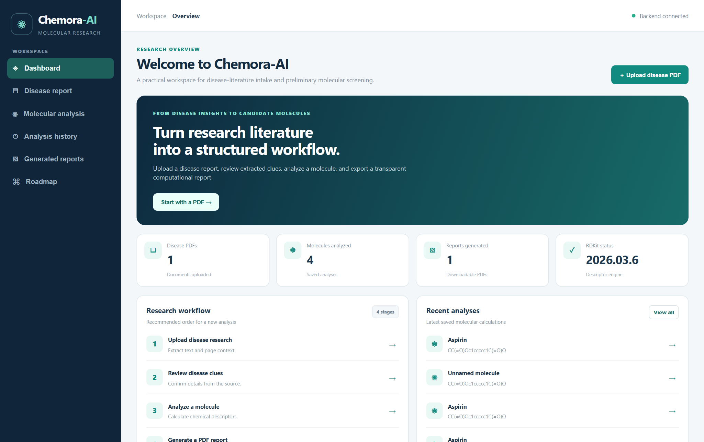
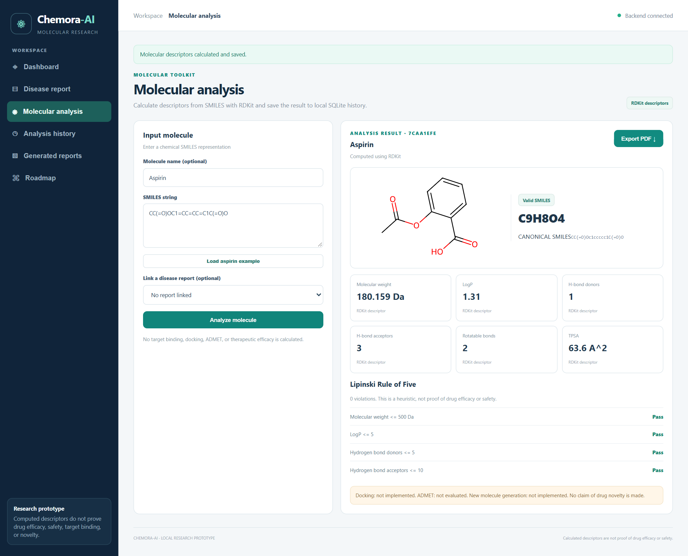
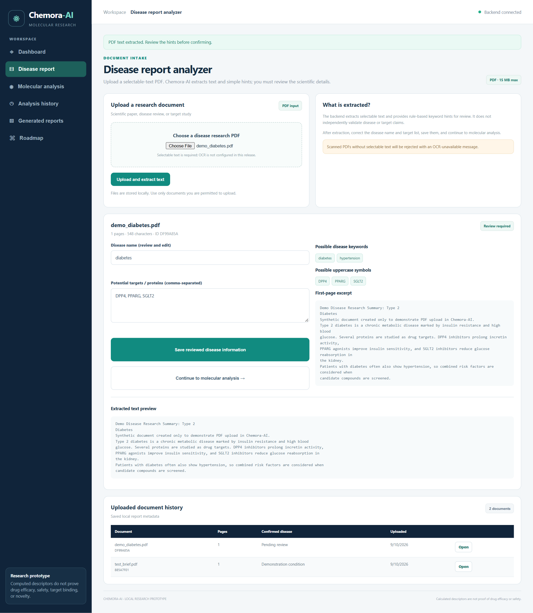
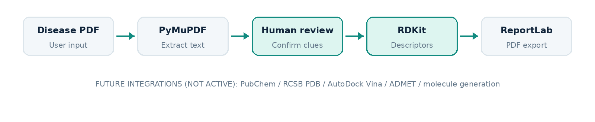

# Chemora-AI

**From disease insights to candidate molecules.**

Chemora-AI is a local web application for early-stage drug-discovery research. It extracts text from disease research PDFs, highlights possible disease terms and protein targets for review, and analyses molecules with RDKit to calculate their descriptors and check their drug-likeness.



## Features

- **PDF intake.** Upload a disease research PDF and extract its text page by page, with validation of file type, size and content.
- **Keyword hints.** See possible disease terms and gene or protein symbols, then review and confirm them before use.
- **Molecular analysis.** Enter a SMILES string to get the molecular formula, weight, LogP, H-bond donors and acceptors, rotatable bonds, TPSA, heavy atom count and a 2D structure.
- **Drug-likeness check.** Each Lipinski Rule of Five criterion is evaluated and shown individually.
- **History.** Every document and analysis is saved in a local SQLite database.
- **PDF reports.** Export any analysis as a downloadable report.
- **REST API.** Interactive documentation at `/docs`.

## Screenshots

| Molecular analysis | Disease report analysis |
|---|---|
|  |  |

## Architecture



| Layer | Technology |
|---|---|
| Frontend | Built-in HTML/JS UI (optional React + Vite app in `frontend/`) |
| Backend | Python, FastAPI, Uvicorn |
| PDF processing | PyMuPDF |
| Cheminformatics | RDKit |
| Storage | SQLite |
| Reports | ReportLab |
| Tests | pytest |

## Getting started

### Requirements

- Python 3.10 or newer
- Node.js LTS (only for the optional React frontend)

### Windows

```powershell
.\setup_windows.ps1
.\start_backend.ps1
```

Then open <http://127.0.0.1:8000/>.

### macOS / Linux

```bash
cd backend
python3 -m venv .venv
source .venv/bin/activate
pip install -r requirements.txt
uvicorn app.main:app --reload
```

### Optional React frontend

With the backend running, open a second terminal:

```powershell
.\setup_frontend.ps1
.\start_frontend.ps1
```

Then open <http://127.0.0.1:5173/>.

## Running tests

```bash
cd backend
pip install -r requirements-dev.txt
pytest -q
```

## API

| Method | Endpoint | Description |
|---|---|---|
| GET | `/api/health` | Service status and RDKit version |
| POST | `/api/disease-reports/upload` | Upload a PDF and extract text |
| GET | `/api/disease-reports` | List uploaded documents |
| GET | `/api/disease-reports/{id}` | Get a document summary |
| PUT | `/api/disease-reports/{id}/confirm` | Save reviewed disease and targets |
| POST | `/api/molecules/analyze` | Calculate descriptors for a SMILES string |
| GET | `/api/history` | List saved analyses |
| GET | `/api/history/{id}` | Get an analysis |
| DELETE | `/api/history/{id}` | Delete an analysis |
| POST | `/api/reports/generate` | Generate a PDF report |
| GET | `/api/reports` | List generated reports |
| GET | `/api/reports/{id}/download` | Download a report |

## Project structure

```
chemora-ai/
├── backend/
│   ├── app/
│   │   ├── main.py            # FastAPI app and routes
│   │   ├── services/          # PDF extraction, RDKit analysis, report generation
│   │   └── static/            # Built-in web UI
│   ├── tests/                 # API tests
│   └── requirements.txt
├── frontend/                  # Optional React + Vite UI
├── assets/                    # README images
└── *.ps1                      # Windows setup and start scripts
```

Uploaded files, generated reports and the database are stored locally in `backend/storage/` and are not committed.

## Roadmap

- OCR for scanned PDFs
- Biomedical named-entity recognition for disease and target extraction
- PubChem and RCSB PDB integration
- Molecular docking with AutoDock Vina
- ADMET property prediction
- AI-based molecule generation
- User accounts and cloud deployment

## Disclaimer

Chemora-AI is a research and educational tool. Keyword hints are not validated target identifications, and passing Lipinski's Rule of Five does not establish a compound's efficacy or safety. All results require expert review and experimental validation.
